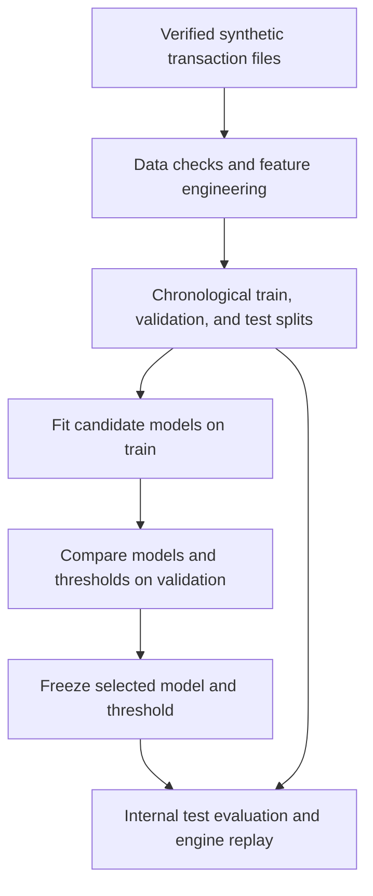
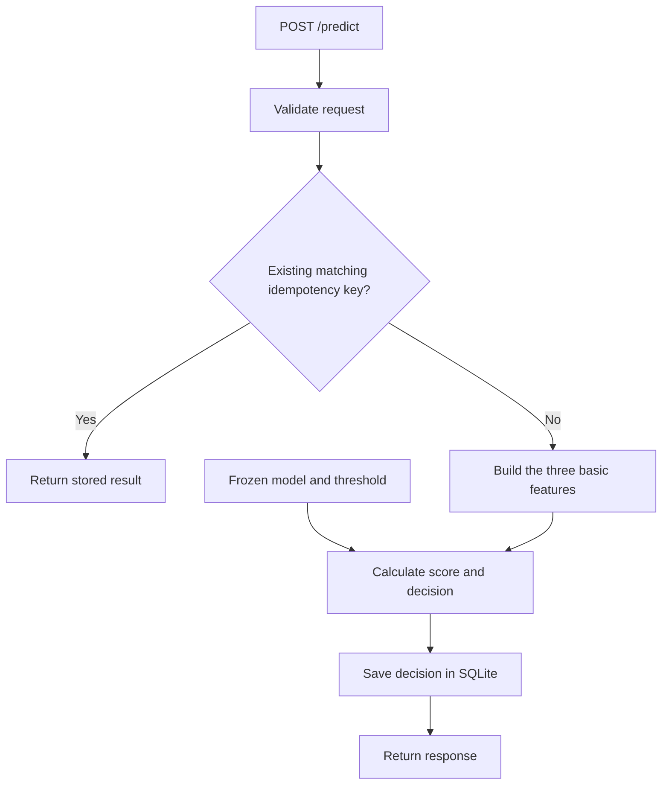

# FraudShield Architecture

FraudShield has two main workflows:
an offline modeling workflow and an online transaction-scoring workflow.

## 1. Offline modeling

This workflow prepares historical data, compares candidate models,
and saves the selected model and decision threshold.

The dataset covers April 2018:

| Split | Period | Purpose |
|---|---|---|
| Train | April 1–18 | Fit model parameters and preprocessing |
| Validation | April 19–24 | Compare models and select a threshold |
| Test | April 25–30 | Evaluate the frozen selection |

The test period has already been examined during project development.
Its results are reported as internal test results.

Both basic and historical feature sets were evaluated.
The selected model is Logistic Regression with three basic features:

- `TX_AMOUNT`
- `TX_HOUR`
- `TX_IS_WEEKEND`

Historical features remain part of the experiments.
They are not required by the selected scoring model.

The frozen model and its selection metadata are stored in
`models/frozen_v1/`.

## 2. Online transaction scoring

The API receives transaction details, validates the request,
and uses the frozen model to calculate a risk score.

The diagram shows successful requests. Invalid inputs, conflicting
idempotency keys, and internal failures have separate error responses.

The active policy is:

| Risk score | Decision |
|---|---|
| Below 0.05 | ALLOW |
| At least 0.05 | REVIEW |

The current policy does not issue BLOCK decisions.

The score is a model output. It should not be presented as a
calibrated probability of fraud without calibration evidence.

## 3. Main components

| File | Responsibility |
|---|---|
| `build_history.py` | Build and check historical features |
| `prepare_history_dataset.py` | Prepare chronological dataset splits |
| `train_history_logistic.py` | Train basic and history Logistic Regression candidates |
| `train_history_tree.py` | Train decision-tree candidates |
| `compare_history_models.py` | Compare validation results and recommend a candidate |
| `freeze_selected_model.py` | Save the selected model, threshold, and provenance |
| `risk_engine.py` | Build serving features and produce scores and decisions |
| `api.py` | Expose HTTP endpoints and validate requests |
| `decision_store.py` | Store decision records in SQLite |
| `idempotency_store.py` | Reuse stored results for matching repeated requests |
| `request_logging.py` | Record HTTP request metadata for troubleshooting |
| `monitor_decisions.py` | Summarize stored decision activity |

## 4. Idempotency and audit records

A repeated request with the same idempotency key and matching
normalized input returns the stored result.

Reusing the key with different input returns HTTP 409.

Without an idempotency key, repeated requests may create separate
decision records. A transaction ID alone is not an idempotency key.

Decision records are stored locally in:
`data/runtime/fraudshield.db`.

HTTP request logs and stored decision records serve different purposes:
request logs describe HTTP activity, while decision records preserve
transaction-scoring results.

## 5. Operational boundaries

- The system uses synthetic data and does not process real payments.
- REVIEW is a recommendation; no analyst assignment workflow is implemented.
- The assumption of 100 reviews per day was used during evaluation.
  It is not an enforced API quota.
- Decision monitoring does not measure fraud detection accuracy
  without confirmed outcome labels.
- Local automated tests and replay checks do not establish
  production readiness or performance under concurrent load.